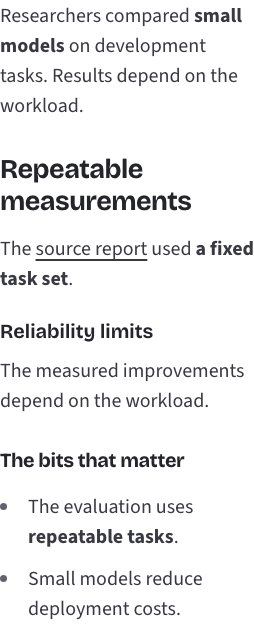
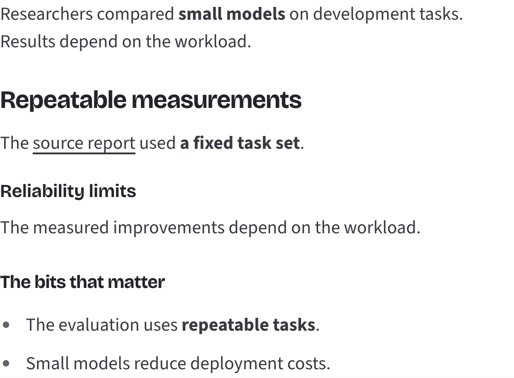

# Article Markdown rendering

Article paragraphs now follow stored CommonMark. The renderer no longer splits
sentences, inserts sentence spacing, or adds a link to the opening text. Explicit
Markdown links, headings, emphasis, lists, quotes and code render as semantic HTML.
HTML remains escaped, images become alt text and unsafe link targets are inert.
The article parser stays out of the client-side feed preview module graph.

Validation on Node 22.23.3:

- PASS: 457 tests across 81 suites; lint, formatting, typecheck and production build.
- PASS: 16 Chromium browser checks at 320, 375, 768 and 1280 pixels, including
  200% text, keyboard focus, no JavaScript, and zero axe accessibility violations.
- PASS: explicit source link opens a new tab with no opener; plain article opening
  has no link; share opens/closes and returns focus; discussion expands/collapses;
  source comments open separately; related article navigation and Back work.
- PASS: existing type, color and spacing tokens are reused. Paragraph spacing
  separates authored blocks, list indentation identifies list hierarchy, and quote
  indentation identifies quoted content. No new decorative assets or copy.

Screenshots use the existing isolated browser fixture:

## Existing malformed content

The renderer does not guess boundaries for headings stored within a single line.
Those summaries require a separate content correction or regeneration. No
production content changes are included in this pull request.
